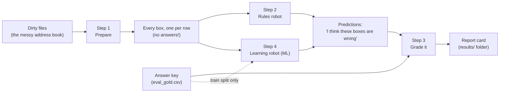

# How Our Project Works (the simple version)

## The story in one paragraph

A company (Stibo) keeps big address books full of people and companies. Address books get messy: someone types an email where the first name should go, or writes "Pending" instead of a real name, or types "test" instead of a phone number. Messy entries cause mistakes later. The worst is thinking two different people are the same person.

**Our job: build a robot that reads every box in the address book and points at the ones that are wrong.**

To check our robot, Stibo gave us a fake address book that they messed up **on purpose**, plus the **answer key** saying exactly which boxes they messed up.

---

## The three kinds of files Stibo gave us

Think of a spelling test:

| Stibo's file | Spelling-test version | What it really is |
|---|---|---|
| `clean_*.csv` | The correct spelling of every word | The address book **before** they messed it up |
| `dirty_person.csv`, `dirty_organization.csv` | The test sheet full of mistakes | The **same** address book **after** they messed it up. This is what our robot reads. |
| `eval_gold.csv` | The teacher's answer key | For every box: what's in it, what should be in it, and what's wrong with it |

> **Important:** the robot only ever gets the test sheet (the dirty files). It never sees the answer key. If it could, it would just copy the answers, and its score would mean nothing.

### One real example: record `AR-014001`

```
                 CLEAN (before)        DIRTY (after)          ANSWER KEY SAYS
first_name   →   Tobias                Pendiente  ❌          "status_token" (a status word, not a name)
middle_name  →   Jazmín                Jazmín     ✅          fine
last_name    →   Gomez                 Gomez      ✅          fine
city         →   Rosario               Rosario    ✅          fine
email        →   gonzalocastillo@...   (same)     ✅          fine
phone        →   +5491120445326        (same)     ✅          fine
```

"Pendiente" is Spanish for "Pending". Someone typed a status word into the first-name box. Our robot should point at that box and say "that's a status word, not a name."

### How big is it?

```
35 countries × 500 people      = 17,500 person records
35 countries × 500 companies   = 17,500 company records
                                 ──────
                                 35,000 records
Each record has 12–13 boxes   → 437,500 boxes total
About 1 in 10 boxes is wrong  →  43,826 bad boxes
```

---

## The big picture



If the diagram above doesn't show up, here's the same thing in plain text:

```
  Dirty files ──► Step 1: Prepare ──► every box (no answers)
                                          │
                         ┌────────────────┴────────────────┐
                         ▼                                 ▼
                 Step 2: Rules robot              Step 4: Learning robot
                         │                                 ▲   │
                         │              (learns from the   │   │
                         │               practice answers) │   │
                         ▼                                 │   ▼
                     Predictions ◄─────────────────────────┼───┘
                         │                                 │
                         ▼                                 │
  Answer key ──────► Step 3: Grade it ──► Report card      │
       └───────────────────────────────────────────────────┘
```

---

## Step 1: Prepare the data (`01_prepare_data.py`)

**ELI5:** Before you can grade a test, you lay out every question neatly and decide which questions are for practice and which are for the real exam.

What it does:

1. **Reads the dirty files carefully.** A normal spreadsheet reader "helpfully" turns the word `NULL` into an empty box. That would erase 4,771 of the mistakes we're supposed to find! So we tell it: keep everything exactly as written.
2. **Hides the answers.** The dirty files have two extra columns describing the mess-ups. We strip those out of what the robot sees.
3. **Cuts every record into boxes.** One row per box, so record `AR-014001` becomes 13 rows (first_name, middle_name, last_name, ...).
4. **Splits records into three piles**, like studying for an exam:

```
  ┌──────────────────────────────────────┬─────────┬─────────┐
  │ TRAIN  70%  (24,500 records)         │ VAL 15% │ TEST 15%│
  │ practice problems WITH answers       │ quizzes │ final   │
  │ (the learning robot studies these)   │         │ exam    │
  └──────────────────────────────────────┴─────────┴─────────┘
```

- **Train:** the learning robot is allowed to study these answers.
- **Val (validation):** practice quizzes, for checking our ideas while we build.
- **Test:** the final exam. We look at it only at the end, so the score is honest.

Every pile gets all 35 countries and every kind of mistake.

**Output:** the `projectscript/data/` folder.

---

## Step 2: The rules robot (`02_rules_detector.py`)

**ELI5:** A checklist of "that's obviously wrong" rules, like a teacher who knows a name never has numbers in it.

It looks at each box and asks questions like:

| Rule | Example it catches |
|---|---|
| Is it a "nothing" word or just punctuation? | `NULL`, `N/A`, `.`, `-`, `unknown` |
| Is it an email sitting in a non-email box? | first_name = `maria@example.com` |
| Is it a phone number sitting in a name box? | org name = `+38623904170` |
| Is it a web link? | address = `https://example.com` |
| Does a person's name have digits or a slash in it? | first_name = `42`, `Jan/Koe` |
| Is it a status word or job title? | `Pending`, `Directeur`, `CEO` |
| Is the phone number real? (checked with a phone library) | phone = `11111111`, `city:Santa Fe` |
| Does the email look like an email? | `a@b@c.com`, `foo@` |

**What it's bad at:** mistakes that look *normal* on their own.

```
  first_name = "Ramos"    last_name = "Theresa"
```

Each box alone looks like a fine name. You only notice the mistake (they're swapped) if you know "Ramos" is usually a last name.

**Output:** `data/rules_predictions.parquet`, the robot's guess for every box.

---

## Step 3: Grade it (`03_score_predictions.py`)

**ELI5:** Compare the robot's answers with the answer key, like grading a test.

For each box there are four possibilities:

```
                       Answer key says WRONG     Answer key says FINE
  Robot says WRONG  →  ✅ caught it               ⚠️ false alarm
  Robot says FINE   →  ❌ missed it               ✅ correctly left alone
```

From those we get two scores:

- **Precision** = "When the robot points at a box, how often is it right?"
  High precision means few false alarms.
- **Recall** = "Of all the wrong boxes, how many did the robot find?"
  High recall means few misses.

Stibo cares a lot about false alarms, because flagging a good record can cause expensive mistakes later. So precision really matters.

The grader also breaks the score down: by box type (first_name, email, ...), by kind of mistake, and by country. Those tables go in the `results/` folder.

---

## Step 4: The learning robot (`04_ml_detector.py`)

**ELI5:** Instead of writing rules by hand, we show the robot thousands of practice examples with answers, and it figures out the patterns itself.

How it learns:

1. **One student per box type.** One learns first names, one learns last names, one learns company names, and so on. Each one learns "what normal looks like" for its box.
2. **It looks at little letter-chunks.** For example, last names in Spanish often end in "-ez" (Gomez, Lopez), and company names often contain "Ltd" or "and". So if "Gomez" shows up in the *first*-name box, the first-name student thinks "hmm, that looks like a last name."
3. **It also gets a few clues from the rest of the record.** Is the middle name empty? Is the last name empty? How many words are in the first name? (If all three names got crammed into first_name, you'd see a long first name and empty middle and last names.)
4. **It studies only the TRAIN pile**, then takes the TEST exam.

We also made a **hybrid**: if *either* robot says a box is wrong, we flag it.

**Output:** `data/ml_predictions.parquet` and `data/hybrid_predictions.parquet`.

---

## The report card (final exam = test pile)

**Recall: how many of the wrong boxes each robot found**

```
Rules robot     ████████████████▌    83.0%
Learning robot  ██████████████████▋  93.4%
Hybrid          ██████████████████▋  93.6%
```

**Precision: how often each robot is right when it points**

```
Rules robot     ████████████████████ 100%   (1 false alarm)
Learning robot  ███████████████████▊ 99.2%  (48 false alarms)
Hybrid          ███████████████████▊ 99.2%  (49 false alarms)
```

In plain words:

- The **rules robot** almost never cries wolf, but it misses about 1 in 6 mistakes.
- The **learning robot** finds about 14 out of every 15 mistakes, with only a handful of false alarms.
- Adding the rules on top of the learning robot barely helps, because the learning robot already learned what the rules know.

### Where the robots still struggle

| Kind of mistake | Example | Why it's hard |
|---|---|---|
| First and last name swapped | first = "Ramos", last = "Theresa" | Both look like normal names |
| Names split in the wrong place | first = "Mar", last = "ia Lopez" | Needs to see both boxes together |
| A person's name in the company box | company = "Jack Duncan" | Some companies are named after people |
| House number removed | address = "Marius Route" | Some real addresses have no number |

These need the robot to look at the **whole record at once**, which is where an **LLM** (like Claude) could help. That's being planned in a separate chat.

### One honest caveat

The fake mistakes were made from a fixed list of words ("Pending", "N/A", "unknown" in many languages). Both robots got to see those same words, the rules through Stibo's word list and the learning robot through the practice pile. Real messy data will have words neither robot has seen, so real-world scores would probably be lower. Stibo warned about this exact thing (their answer GT-04).

---

## Where everything lives

```
Class/
├── HOW_IT_WORKS.md               ← this file
├── answerqs.txt                  ← report draft
└── party-test-data-v3/           ← Stibo's package
    ├── dirty_*.csv               ← the messy address book (robot reads this)
    ├── clean_*.csv               ← the original, before the mess
    ├── eval_gold.csv             ← the answer key
    ├── questions_and_answers.md  ← Stibo's rulings on tricky cases
    ├── taxonomy/                 ← the list of "what's wrong" labels
    └── projectscript/            ← OUR work
        ├── 01_prepare_data.py    ← Step 1: lay out the boxes, make piles
        ├── 02_rules_detector.py  ← Step 2: rules robot
        ├── 03_score_predictions.py ← Step 3: grader
        ├── 04_ml_detector.py     ← Step 4: learning robot
        ├── data/                 ← prepared data + robots' guesses
        └── results/              ← report cards (CSV tables)
```

To rerun everything, from the `Class` folder:

```zsh
.venv/bin/python party-test-data-v3/projectscript/01_prepare_data.py
.venv/bin/python party-test-data-v3/projectscript/02_rules_detector.py
.venv/bin/python party-test-data-v3/projectscript/04_ml_detector.py
.venv/bin/python party-test-data-v3/projectscript/03_score_predictions.py hybrid_predictions.parquet --split test
```

(Step 4 runs before the last Step 3 command because the grader needs the learning robot's guesses first.)

---

## Mini glossary

| Word | Simple meaning |
|---|---|
| **Record** | One row in the address book: one person or one company |
| **Field / box** | One piece of a record, like first_name or phone |
| **Dirty** | Wrong or messed up |
| **Placeholder** | A fake "nothing" value like `NULL`, `N/A`, `test`, `.` |
| **Label** | The name for *what kind* of wrong, e.g. `status_token`, `corrupt_phone` |
| **Gold / answer key** | The correct answers, used only for grading and practice |
| **Train / val / test** | Practice problems / quizzes / final exam |
| **Rules** | Hand-written checks |
| **ML (machine learning)** | A program that learns patterns from examples |
| **LLM** | A large language model, like Claude, that reads text and reasons about it |
| **Precision** | When it says "wrong," how often it's right |
| **Recall** | Of all the wrong things, how many it found |
| **Hybrid** | Using both robots together |
